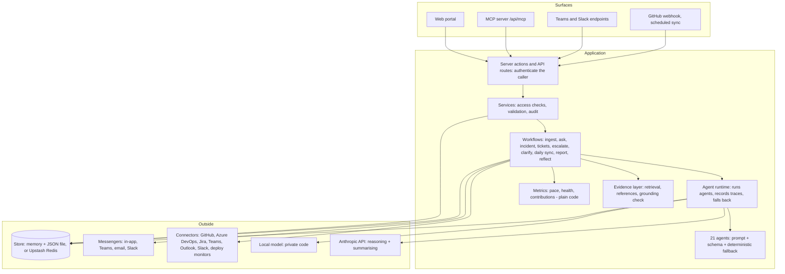

# Architecture

Project Aid is one Next.js application (App Router, TypeScript) that deploys to Vercel.

**Orchestration harness.** The multi-agent orchestration is an in-house runtime (`src/lib/agents/runtime.ts`, about 400 lines) with workflows written as ordinary TypeScript. No agent framework is used: no LangChain, LangGraph, CrewAI, AutoGen or Claude Agent SDK. The reasons are control and auditability: routing, permissions, approval gates and escalation policy stay in code that can be tested, every step lands in a trace, and every agent has a deterministic fallback. Model access is a thin provider layer: the Anthropic SDK directly, or a LiteLLM gateway for every call.



## Source layout

| Path | Contents |
|---|---|
| `src/lib/types.ts` | The domain model shared by everything |
| `src/lib/agents/runtime.ts` | Agent runtime: `defineAgent`, `runAgent`, `runTextAgent`, `runToolAgent`, `codeStep`, run traces |
| `src/lib/agents/defs/` | One file per agent or agent family |
| `src/lib/workflows/` | Orchestrations that compose agents |
| `src/lib/knowledge/evidence.ts` | Evidence bag, lexical retrieval, grounding verification |
| `src/lib/llm/` | Provider routing (Anthropic SDK, local model), privacy rules |
| `src/lib/connectors/` | Source connectors, deployment monitors, messengers, document parser |
| `src/lib/metrics/` | Pace and contribution calculations |
| `src/lib/services/` | Read models and commands with access control; `snapshot.ts` holds the health rules |
| `src/lib/tools/registry.ts` | The tool surface exposed over MCP |
| `src/lib/security/` | Redaction, untrusted-content wrapping, signatures, rate limiting, audit |
| `src/lib/auth/` | Sessions, passwords, project access, personal access tokens |
| `src/lib/store/` | Document store interface with memory and Redis adapters |
| `src/lib/seed/` | Demo portfolio and the event simulator |
| `src/app/` | Pages, server actions (`actions.ts`), API routes |
| `src/components/` | Design system, charts, domain components, feature components |

## The agent runtime

An agent is a small, single-purpose definition:

```ts
defineAgent({
  name: "fix-reviewer",
  tier: "smart",            // "smart" = reasoning model, "cheap" = summarising model
  version: "1.0",           // recorded on every step, so traces compare across prompt versions
  system: "...",            // stable instructions
  schema: ReviewSchema,     // zod schema; the model's output is validated against it
  prompt(input) { ... },    // builds the task; outside content is wrapped as untrusted data
  fallback(input) { ... },  // deterministic implementation used with no model or on failure
});
```

Three kinds exist: structured agents (validated JSON out), text agents (markdown out, optionally streamed) and tool agents (a loop with read-only tools, used by the researcher and the incident investigator).

Workflows compose agents in ordinary code: sequence, `Promise.all` for parallel fan-out, loops for propose-and-review. This keeps control flow, permissions and policies deterministic and testable, while the judgement inside each step comes from a model.

Every workflow runs inside a traced run. Each step records the agent, tier, provider, model, whether it ran live or on the fallback, duration, tokens, estimated cost, tool calls, input and output previews, and any error. Traces are visible under "Agent runs" and attached to every answer, report and incident.

**Degradation.** If no model is configured, or a call fails (rate limit, refusal, invalid output, timeout), the step runs its fallback and the trace says so. A workflow never fails because a model did.

### Agents

| Agent | Tier | Role |
|---|---|---|
| summarizer | cheap (or local) | Summarises one commit, pull request, message, document or deployment |
| router | cheap | Works out which projects, people, timeframe and action a question involves |
| researcher | cheap, tools | Per-project specialist that gathers findings with read-only lookups |
| composer | smart | Writes the cited answer |
| verifier | cheap | Independently checks the answer against its evidence |
| ticket-extractor | smart | Splits a message into ticket drafts and open questions |
| ticket-deduper | cheap | Flags drafts that repeat an open ticket |
| incident-investigator | smart, tools | Reads the failure log and the changes since the last healthy release |
| incident-triager | smart | Severity, likely cause, confidence, impact, next steps |
| fix-proposer | smart | Smallest reversible fix with rollback and test plans |
| fix-reviewer | smart | Independent challenge of the proposed fix |
| clarifier | cheap | Decides whether to ask an author about an unclear change, and what |
| escalation-drafter | cheap | Writes the question sent to a team member |
| knowledge-distiller | cheap | Turns a reply into a citable knowledge event |
| activity-analyst | cheap | Groups a day's activity into themes |
| release-notes-writer | cheap | Writes client-readable release note cards |
| risk-scout | cheap | Finds risks and what is next |
| digest-editor | smart | Merges the three drafts into the daily sync |
| report-writer | smart | Fills a report template from evidence |
| report-reviewer | cheap | Checks a report and may send it back once |
| reflector | smart | Turns feedback into proposed lessons |

### Model routing

`src/lib/llm/index.ts` is the only place that decides where a model call goes. Agents ask for a tier (`smart` or `cheap`), never for a vendor.

| Configuration | Where calls go |
|---|---|
| `LITELLM_BASE_URL` set | **Every** call goes through the LiteLLM gateway (OpenAI-compatible chat completions): structured output, streaming and tool loops. The `smart` and `cheap` tiers map to model names defined in your LiteLLM configuration, so any vendor LiteLLM supports can sit behind them, with its budgets, fallbacks and logging. |
| `ANTHROPIC_API_KEY` set, no gateway | Direct to Anthropic through its SDK: `claude-opus-5-5` for reasoning (with the server-side refusal fallback), `claude-haiku-5-5` for summarising. |
| Neither | Heuristic mode: every agent runs its deterministic fallback. |

Steps that read source code also follow the project's privacy mode, whatever the gateway: `cloud` uses the summarising tier; `local` uses only a model on your own hardware (`LITELLM_LOCAL_MODEL` through the gateway, or `LOCAL_LLM_BASE_URL` directly) and falls back to rules if none is configured; `metadata-only` never calls a model.

Through LiteLLM, structured output is requested as a strict JSON schema; if a model rejects that, the provider switches that model to JSON mode with the schema in the prompt, validates the reply and allows one repair attempt. The gateway's reported cost per call is recorded in the trace when it sends one.

## Grounding

1. A workflow collects records into an `EvidenceBag`. Each record gets a short reference: `E` event, `T` ticket, `D` deployment, `I` incident, `M` computed metric, `Q` team question, `N` the PD's own note, `G` daily sync, `R` report.
2. Agents are told to cite a reference for every factual statement and to say plainly when something is not in the evidence.
3. After generation, code removes references that do not exist, then checks what share of the factual statements carry a valid reference. The verifier agent independently checks that the cited evidence supports what is said.
4. The result (score, unsupported statements, verdict) is stored with the answer and shown as a badge. When the evidence does not answer the question, the assistant proposes asking the best-placed team member.
5. Health, progress, pace and contribution figures are computed in `src/lib/metrics` and `src/lib/services/snapshot.ts` and passed to agents as metric evidence. No model produces a number or a health colour.

Retrieval is lexical with recency and importance boosts. It is dependency-free and adequate for tens of projects; the `searchEvents` interface is where embeddings would go.

## Security

| Concern | Control |
|---|---|
| API keys | Read from environment variables by the SDK. Never in code, the database, logs or responses. Sources reference a credential by environment variable name. The setup page reports only whether a variable is set. |
| Sign-in | scrypt password hashes; HMAC-signed, expiring, HTTP-only, same-site session cookies; login rate limiting; production fails closed without `AUTH_SECRET`. |
| Authorisation | Every service function takes the caller and checks project access. A PD sees only projects they direct. "Not found" and "not yours" are indistinguishable. Team members have no portal access. Chats and notes are private to their owner. |
| API and MCP access | Personal access tokens, stored as SHA-256 hashes, shown once, read-only or read-write, revocable, rate limited. MCP tools run as the token's owner through the same services. |
| Prompt injection | Everything from repositories, chats and documents is redacted, wrapped in a delimited block and declared to be data in every system prompt. Agents that read untrusted content have no write tools. Routing decisions (who is contacted, which project) are made in code against the project's team. Instruction-like text is tagged and written to the audit log. |
| Secret leakage | Credentials are stripped by pattern before any model sees content and before anything is stored. |
| Proprietary code | Per-project privacy mode; raw diffs are dropped after summarising by default. |
| Unsafe automation | Tickets, questions to the team, fixes and lessons need a human click. Fix proposals pass mechanical safety checks that the reviewing model cannot override. Nothing is merged or deployed by the system. |
| Webhooks and schedules | HMAC verification for GitHub, Slack and Teams; bearer secret for the scheduled job; endpoints are closed when their secret is not configured. Outbound replies to Slack only go to `hooks.slack.com`. |
| Public reply links | 192-bit random token, only its hash stored, rotated when the PD follows up; the page reveals nothing for a bad token and is rate limited. |
| Browser | Security headers (no framing, no sniffing, strict transport, restricted permissions); rendered markdown never executes raw HTML; same-origin check on the chat endpoint. |
| Audit | Sign-ins, configuration changes, ingestion, redactions, suspected injections, agent-initiated messages, approvals and tool calls are recorded. |

## Self-improvement

- **Feedback.** Thumbs up or down, with a comment, on answers, reports and daily syncs.
- **Reflection.** The reflector agent reads unprocessed feedback together with the run trace that produced the output and proposes lessons: short, general instructions for a specific agent, global or per project. It never proposes weakening grounding, privacy or approval rules.
- **Approval.** A PD approves or dismisses each lesson. Approved lessons are appended to the targeted agents' instructions on every later run; they can be retired at any time.
- **Knowledge.** Answers to clarifying questions and escalations are stored as citable events, so the same question is answered from the record next time.
- **Regression questions.** A PD pins questions with facts the answer must mention. "Run all" replays them and reports pass or fail with the grounding score, which catches regressions after a prompt, model or lesson change.
- **Quality metrics.** The Learning page aggregates traces: grounding scores, share of steps that ran live, model failures that fell back, cost, and a per-agent breakdown. Agent prompt versions are recorded on each step.

## Data and scaling notes

The store is a document store behind one small interface. The in-memory adapter (with a JSON snapshot on disk) is for local development and demos; the Upstash Redis adapter is for serverless. Each collection is one Redis hash, which is fine for tens of projects. For a large portfolio, move `events` and `runs` to a relational store with indexes on project and time; only `src/lib/store` and the list calls in `src/lib/knowledge/evidence.ts` change.

Long workflows run inside the request that started them (up to five minutes on Vercel). The GitHub webhook and Slack endpoint acknowledge first and continue after the response. A queue would be the next step for heavy ingestion.

## Testing

`npm test` runs about 150 tests with models switched off, so they exercise orchestration, access control and the deterministic fallbacks:

- unit tests for connectors, metrics, templates, redaction, signatures, sessions and grounding
- workflow tests for tickets, escalation, clarification, threads, daily sync, reports and reflection
- `tests/integration.test.ts`: the seeded portfolio end to end (assistant, incident, ingestion safety, learning loop, access control)
- `tests/mcp.test.ts`: the MCP endpoint over real JSON-RPC requests

`npm run check:llm` exercises the live model call shapes (structured output, streaming, tool loop) on both tiers, through whichever route is configured. The LiteLLM route was run against a real LiteLLM proxy (version 1.109) with a stand-in upstream model; the direct Anthropic route has only been run against a stubbed API.

Running costs per workflow are estimated in [COSTS.md](COSTS.md).
