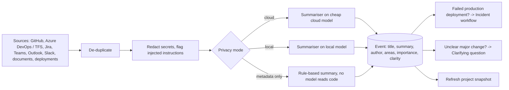
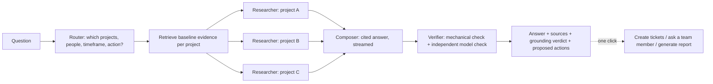
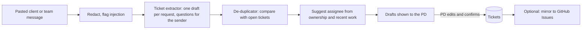
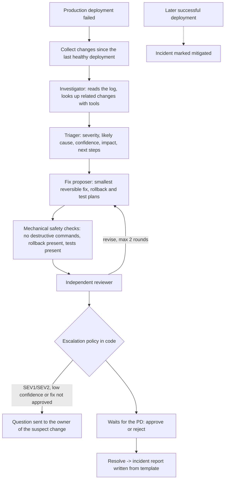
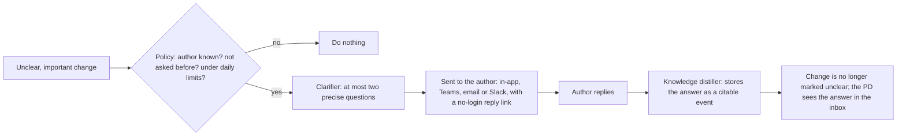
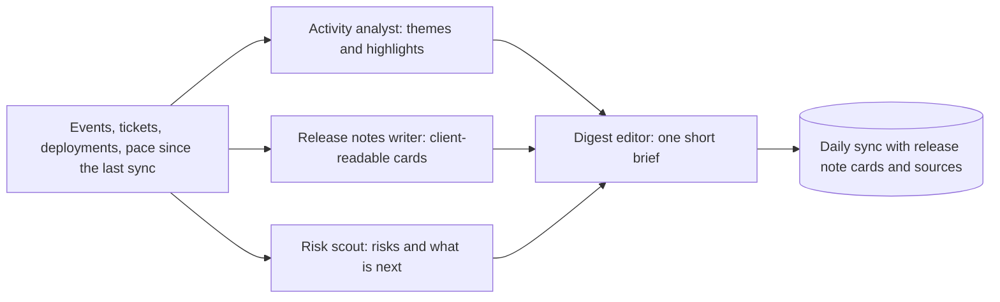
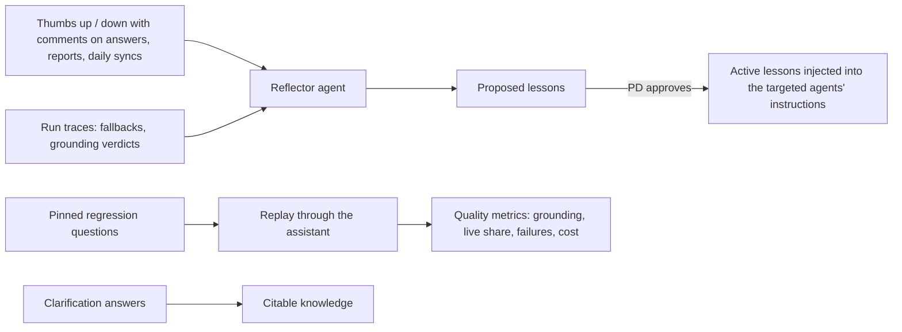

# Project Aid: product scope

Project Aid is a command center for project directors (PDs) at a software house. A PD runs several client projects at once, spends the day in meetings, and loses context every time they switch. Project Aid watches each project's repositories, boards, chat and deployments, keeps a grounded record of what happened, and puts a team of AI agents on top of that record to summarise, answer questions, convert messages into tickets, triage failed deployments and chase unclear changes.

## Who it is for

| Person | What they need | How Project Aid helps |
|---|---|---|
| Project director | Know the state of every project in two minutes, without asking anyone | Portfolio view, daily sync, chat with citations |
| Project director | Answer a client question during a call | Ask the assistant; every statement links to its source |
| Project director | Turn a client message into work | Message to ticket, with drafts to confirm |
| Project director | Hear about a failed release before the client does | Automatic triage, reviewed fix proposal, escalation |
| Developer | Not be interrupted for status | The system answers from the record; it asks only when a change is unclear |
| Senior management | Evidence that the tool can be trusted | Grounding verdicts, agent traces, audit log, per-project privacy modes |

## Design principles

1. **Grounded or silent.** Agents answer only from stored records and cite them. Numbers (progress, pace, counts) and project health are computed in code, never by a model. Anything the record does not cover is said to be missing, and the PD is offered the right person to ask.
2. **People approve, agents propose.** Nothing is created, sent, merged or deployed without a click from the PD: tickets are drafts, fixes are proposals, lessons are suggestions.
3. **Cheap models read, capable models reason.** Long inputs such as diffs are summarised once on a cheap (optionally local) model; the capable model only ever sees the summaries.
4. **Useful with nothing connected.** With no API key every agent runs on a deterministic fallback, and with no integrations a simulated source keeps the product explorable.
5. **Each feature is a switch.** Every capability can be turned on or off per project.

## Workflows

Every workflow below is implemented end to end. "Trigger" lists how it starts.

### 1. Ingest and summarise

Trigger: "Sync now", the daily schedule, a GitHub webhook, a document upload, or a demo scenario.

Raw diffs are discarded after summarising unless the project opts in to keeping them. Every event is attributed to a team member through their GitHub, Azure DevOps, Jira, Teams or Slack identity, so changes are traceable per person.

### 2. Ask the assistant (chat)

Trigger: the chat page, the search box, a project chat, an MCP client, Teams or Slack.

Researchers run in parallel, one per project, and may call read-only tools (search activity, list tickets, deployments, incidents, team questions). The router can only pick projects the caller is allowed to see.

### 3. Message to ticket

Trigger: "Turn a message into tickets" on the Tickets tab, a chat message ("turn this into tickets: ..."), or MCP.

### 4. Deployment monitoring and incident handling

Trigger: a failed or degraded production deployment seen by a deployment monitor or a source.

The owner is derived in code from the author of the suspect change, never from model text. A failed mechanical check cannot be overridden by the reviewing model. Approval records the decision and hands the plan to the owner; applying a patch to a repository is deliberately stubbed (see Assumptions in the README).

### 5. Clarifying questions

Trigger: the summariser marks a significant change as unclear (for example a 40-file commit titled "wip").

This is how the system prepares itself to answer questions later instead of interrupting the team when the PD asks.

### 6. Escalation

Trigger: the PD clicks "Ask the author" on a change, accepts the assistant's suggestion to ask someone, or uses "Ask a team member".

The owner finder ranks the project team by declared areas and recent related work, the drafter writes a short, respectful question with the relevant context, and the message goes out on the project's channel. The thread lives in the PD's inbox; the reply arrives there and becomes citable knowledge.

### 7. Daily sync

Trigger: the daily schedule, the "Generate today's sync" button, or MCP.

### 8. Reports from templates

Trigger: the Reports tab, the assistant ("write the progress report"), resolving an incident, or MCP.

Progress reports, release notes and incident reports are written into a markdown template (editable per project) by a writer agent, checked by a reviewer agent, revised once if needed, and stored with citations and a grounding verdict. Reports can be copied, downloaded or printed.

### 9. Progress, pace and contributions

Computed in code on every sync: progress against scope, schedule elapsed, weekly throughput, velocity trend, projected completion and slip, and a rule-based health (green, amber, red) with its reasons. Per-person contribution summaries (commits, pull requests, reviews, tickets closed, active days, response time) are shown as activity signals with an explicit note that they are not a performance rating.

### 10. Notes

A PD keeps private notes per project. Notes marked "let the assistant use this" are added as evidence when that PD, and only that PD, asks a question.

### 11. Learning loop

See [ARCHITECTURE.md](ARCHITECTURE.md#self-improvement) for how each part works.

### 12. Access from anywhere

| Surface | Status |
|---|---|
| Web portal (desktop and phone) | Implemented |
| MCP server at `/api/mcp` (Claude, Copilot Studio, IDEs, any MCP client) | Implemented and tested |
| Microsoft Teams: @mention the assistant (outgoing webhook) | Implemented; needs a Teams admin to register the webhook |
| Slack: slash command | Implemented; needs a Slack app |
| Outbound questions to the team: in-app, Teams, email, Slack | In-app works out of the box; the others need a webhook URL or API key |

## Integrations

| Integration | Purpose | Status | What it needs |
|---|---|---|---|
| GitHub | Commits with diffs, pull requests, issues, deployments, Actions runs; optional issue mirroring | Implemented, tested against recorded fixtures, not yet run against a live repository | `GITHUB_TOKEN` (optional for public repositories) |
| Azure DevOps / TFS | Commits, pull requests, work items | Implemented, not yet run live | `AZURE_DEVOPS_PAT` |
| Jira | Issues and status changes | Implemented, not yet run live | `JIRA_API_TOKEN` |
| Microsoft Teams (read) | Channel messages | Implemented, not yet run live | `MS_GRAPH_TOKEN` from an Entra app registration |
| Outlook | Mailbox messages | Implemented, not yet run live | `MS_GRAPH_TOKEN` |
| Slack (read) | Channel messages | Implemented, not yet run live | `SLACK_BOT_TOKEN` |
| Documents | Word, Excel, CSV, Markdown, text uploads | Implemented | Nothing |
| Deployment status | Vercel, GitHub deployments or Actions, HTTPS health checks | Implemented, tested against fixtures | `VERCEL_TOKEN` / `GITHUB_TOKEN` / a URL |
| Azure deployment status | - | Stub | - |
| Anthropic API | Agent reasoning and summarising | Implemented; see the README for the verification script | `ANTHROPIC_API_KEY` |
| Local model | Summarising proprietary code on your own hardware | Implemented | `LOCAL_LLM_BASE_URL` |
| Upstash Redis / Vercel KV | Durable storage on serverless | Implemented | `UPSTASH_REDIS_REST_URL`, `UPSTASH_REDIS_REST_TOKEN` |
| Applying fixes as pull requests | Opening a draft PR from an approved fix | Deliberately stubbed | A token with write access and a decision to allow it |

## Prioritisation

Ranked by impact for a PD against integration friction. Everything in the first two groups is built; the third is the roadmap.

**Built first: high impact, no external dependency**
1. Portfolio view with rule-based health, pace and attention list
2. Chat with citations, grounding verdict and agent trace
3. Ingestion pipeline with redaction and privacy modes
4. Message to ticket
5. Incident triage with reviewed fix proposal and escalation
6. Daily sync with release note cards
7. Clarifying questions and escalations with a no-login reply link
8. Reports from templates
9. MCP server
10. Learning loop (feedback, lessons, regression questions)

**Built, needs credentials to go live**
11. GitHub, Azure DevOps / TFS, Jira, Teams, Outlook, Slack connectors
12. Vercel, GitHub and health-check deployment monitors
13. Teams, Slack and email delivery; Teams and Slack chat entry points
14. Durable storage, scheduled sync, GitHub webhook

**Next**
15. Full Teams bot with proactive messages and adaptive cards for approvals
16. Opening draft pull requests from approved fixes, with CI status fed back into the incident
17. Embedding-based retrieval and a relational store for large portfolios
18. Single sign-on with Microsoft Entra ID
19. Client-facing read-only status pages
20. Capacity planning across projects from the contribution data
